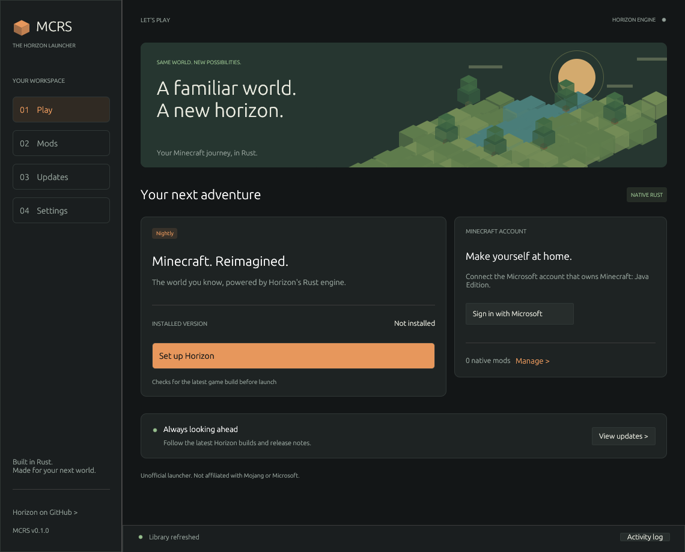

# MCRS Launcher

A lightweight, fully native Rust desktop launcher for [Horizon](https://github.com/horizon-rust/horizon), the Rust implementation of Minecraft. Built with egui/eframe; no bundled browser, JavaScript runtime, or local web server.



Download the Flatpak or a native desktop archive from [GitHub Releases](https://github.com/marktible/mcrslauncher/releases/latest). Published packages include SHA-256 checksums.

For launcher updates through `flatpak update`, install from the [signed Flatpak repository](https://raw.githubusercontent.com/marktible/mcrslauncher/flatpak-repo/io.github.marktible.MCRSLauncher.flatpakref). Existing bundle installations can switch to that remote; see the [Flatpak guide](docs/flatpak.md).

## Run

For a desktop Flatpak installation, see [Flatpak packaging](docs/flatpak.md). Build and install a local bundle with `python3 scripts/build-flatpak.py --install`.

Install [Rust](https://rustup.rs/) (1.88 or newer), then:

```sh
cargo run --release --locked
```

On Linux, the launcher uses the system's OpenGL and X11 or Wayland libraries. The game additionally needs Horizon's [platform requirements](https://playhorizon.dev). On Windows, build using the Rust MSVC toolchain and Visual Studio C++ build tools. macOS builds use Xcode command line tools.

1. Select **Set up Horizon**. MCRS downloads the current official Horizon launcher engine, checks its GitHub SHA-256 digest, and installs only its executable.
2. Select **Sign in with Microsoft**. Enter the displayed device code in Microsoft's website using an account that owns Minecraft: Java Edition. No passwords are collected by MCRS.
3. Select **Play Horizon**. The latest Nightly game is installed, the matching Minecraft resources are prepared from Mojang for your account, and the game starts. Horizon manages any Java runtime needed for preparation.
4. In **Mods**, paste a compatible GitHub repository URL, review and trust its native source, then select **Import & build**. Horizon installs its pinned source and toolchain, builds the mods, and selects the resulting game for play.

The first resource preparation or native mod build can take several minutes and several GB of storage. Subsequent launches reuse prepared resources and builds.

Preparation retries temporary DNS, connection and server-availability failures up to three attempts, reusing completed downloads. Cancel also stops retry waits. If connectivity stays unavailable, restore the connection and press Play again to resume.

GitHub update checks also retry temporary network failures. If a check stays unavailable, the Updates page shows that status and retains any last-known release details without claiming they are current. Play can continue with a verified, prepared installed build when there are no pending mod changes; Horizon still checks the Minecraft account. Explicit installation requests require a successful update check.

The desktop window resizes down to 480×360. Narrow windows use compact top navigation and stacked Play cards; action rows wrap, content scrolls, and dialogs can be resized. Wide windows keep the sidebar, whose width can also be adjusted.

Use `--page mods`, `--page updates`, or `--page settings` to open a page directly. Ctrl+1 through Ctrl+4 switch pages inside the app.

## Features

- Microsoft device-code authentication, ownership checks, account selection and sign-out through Horizon's official CLI. Horizon manages credentials and keychain integration.
- Persistent download progress with percentage, transferred bytes, speed, ETA and elapsed time. Preparation and builds show activity when a percentage is unavailable.
- **Open game folder** opens the active instance directly from Play or Settings.
- Actual Minecraft skin heads, cached locally with their hat layer. **Change skin** opens a PNG picker and applies classic or slim skins to the signed-in Java Edition account.
- GitHub native mod import from repository, branch, commit or release URLs; incremental builds, source links, removal with rebuilding, and explicit trust before importing new mod source.
- Separate engine and game release discovery. Nightly is selected by default; immutable `nightly-<date>-<commit>` versions and asset digests detect new builds even when the GitHub tag stays `nightly`.
- Startup and 15-minute update checks; update before play is enabled by default. Stable channel and manual checks are available.
- Native Rust rendering, idle rendering suspension, bounded process logs, background I/O and compilation, cancellation of process trees, and optional minimization during play.
- Performance, release (thin LTO), and development build profiles. Performance is the default for fast incremental rebuilds without the development profile's game slowdown.

Only **Horizon native mods** are imported by this launcher. Java/Fabric/Forge `.jar` mods do not run in Horizon. Native mods can pin a Horizon revision; upstream compatibility checks remain enforced, so a mod may require an older game or need updating before the latest game can build.

## Updates and offline use

**Updates** shows the chosen channel, latest game and engine builds, and release notes. **Install latest build** verifies the upstream game's signed checksums through Horizon's installer. The engine itself is checked against the SHA-256 digest published by the GitHub Releases API and verified locally before use. Unsigned source builds are never substituted for official releases.

For an installed and prepared game, turn off **Install the newest build before playing** in Settings to launch without a GitHub update check. Account renewal and cached ownership handling remain Horizon's responsibility. Turning off startup checks also prevents automatic GitHub checks. Failed checks leave the installed game intact and report the error.

Game updates rebuild installed native mods only when the base build changes or a native build is missing. The exact build base is prepared before compilation; game updates use their catalog version, and ordinary rebuilds retain the existing native revision. Mod source updates require a separate trust confirmation. Resource preparation is skipped once the target build has both its resource manifest and sound resources.

Installing a newer Nightly removes older Nightly builds that are neither selected nor used by an instance, matching Horizon's own update cleanup. Release versions keep Horizon's configured number of newest builds, and compiled native builds follow Horizon's spare-build policy.

Failed or cancelled mod builds remain marked as pending. Play retries the build before starting the game, so an older compiled mod set is not launched silently after source changes.

## Storage

The application uses the platform application-data directory reported by the `directories` crate. **Settings → Open data folder** opens it. Override it with `MCRSLAUNCHER_HOME` for portable or isolated use:

```sh
MCRSLAUNCHER_HOME=/path/to/launcher-data cargo run --release --locked
```

```text
settings.json        MCRS preferences (no credentials)
runtime/             verified official engine and download receipt
horizon-launcher/    engine-managed accounts, versions, build cache and toolchains
game/                worlds, options and mods
```

Existing official Horizon launcher data is not modified. MCRS provides its own `HORIZON_LAUNCHER_HOME` and `HORIZON_HOME` to child processes. Official engine releases provide Microsoft's application ID. A custom upstream engine can use the upstream `HORIZON_MSA_CLIENT_ID` environment variable; see [Horizon authentication documentation](https://github.com/horizon-rust/horizon/blob/main/docs/microsoft-account.md).

## Development and verification

```sh
cargo fmt --check
cargo clippy --locked --all-targets -- -D warnings
cargo test --locked
cargo build --release --locked
```

The opt-in live contract test downloads the official engine and current Nightly game into a temporary folder, verifies their checksums, and exercises the actual CLI's account, installation and version JSON interfaces. It does not sign in, download Minecraft assets, or launch the game:

```sh
cargo test --locked --test upstream -- --ignored --nocapture
```

`src/github.rs` owns release discovery and verified engine extraction. `src/engine.rs` is the typed subprocess bridge. `src/worker.rs` serializes game operations away from the UI thread. `src/progress.rs` observes the installer's archive file instead of relying on terminal-only progress output. `src/profiles.rs` caches public skins and handles the file chooser and skin upload independently of downloads. `src/ui.rs` implements the desktop interface. Logs are capped at 500 displayed lines and 128 KiB of captured output per process stream.

The game and profile workers sleep when idle. The UI redraws on input, worker events and scheduled checks. Preparation's activity bar uses a smooth animation while visible; measured downloads update on worker events, and idle screens have no animation loop. Performance depends on the system and mods; no game FPS improvement is claimed by the launcher.

Horizon remains responsible for sign-in and refresh credentials. For a requested skin upload, the profile worker consumes Horizon's private read-once session handoff, removes that file immediately, and sends its temporary Minecraft access token only to Minecraft's skin service. The skin handler does not persist tokens or send them to UI events, activity logs, or skin-image hosts.

See [validation notes](docs/validation.md) for the checks actually completed, performance observations, and remaining live-test limits.

## License and attribution

MCRS Launcher is MIT licensed. Horizon is a separate, MIT-licensed upstream project by its contributors. Its executable is downloaded from official GitHub releases on first setup; it is not bundled here. Dependencies retain their own licenses. Minecraft code and assets are never included in this repository. An eligible Minecraft account is required to obtain and prepare them.

Unofficial software. Not approved by or associated with Mojang or Microsoft.
